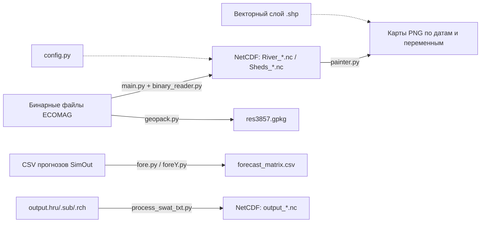

# EcomagNetcdf

Набор утилит для работы с результатами гидрологической модели **ECOMAG NGMS** (и частично SWAT):
чтение «сырых» бинарных файлов модели, запись их в **NetCDF**, картографическая визуализация
и постобработка прогнозных рядов.

## Состав проекта

| Файл | Назначение |
| --- | --- |
| `main.py` | Точка входа: бинарные файлы ECOMAG → NetCDF |
| `binary_reader.py` | Универсальный низкоуровневый читатель/писатель бинарных буферов (сторонняя библиотека, MIT) |
| `config.py` | Справочник переменных: имена, группы (пиксели/водосборы), `long_name`, единицы |
| `paths_config.py` | Централизованная конфигурация всех путей проекта |
| `nc_functions.py` | Функции записи NetCDF-файлов (`River_*.nc`, `Sheds_*.nc`) |
| `painter.py` | Построение карт по NetCDF + векторному слою, сохранение PNG |
| `geopack.py` | Геопривязка рядов к полигонам, чтение топологии речной сети |
| `EcomagBinaryReader.py` | Пустой файл-заглушка (только пробельные символы) |
| `fore.py` | Прогнозные матрицы по всем сайтам (лаги −4…7) |
| `foreY.py` | Прогнозные матрицы с разбивкой по годам выпуска (лаги 0…7) |
| `swat/process_swat_txt.py` | Текстовые выходы SWAT (`output.hru/.sub/.rch`) → NetCDF |

## Поток данных

## Описание файлов

### `main.py`
Основной сценарий конвертации бинарных результатов ECOMAG в NetCDF.
Запуск: `python main.py [<каталог_с_бинарными_файлами> <каталог_результатов>]`
(каталог результатов создаётся автоматически). Если аргументы не переданы, используются
`ECOMAG_BINARY_DIR` и `ECOMAG_RESULTS_DIR` из `paths_config.py`.

Что делает:
- перечисляет все файлы во входном каталоге;
- по имени файла определяет переменную (всё до 8-значной даты набора) и метку даты
  (`get_vname_dts_str`);
- раскладывает файлы на группы `pixel_vars` и `shed_vars` по `config.py`;
- читает двоичные данные двумя способами: `read_file()` — заголовок `int64`, массив `double`;
  `read_file4()` — `int32` + `float` (используется по умолчанию, `kind=4`);
- формат записи: сначала число элементов `item_count`, затем идентификаторы элементов
  (`Nset`), далее повторяющиеся блоки `yyyymmdd` + `item_count` значений;
- `read_files()` собирает данные в структуру `{метка_даты: {переменная: {yyyymmdd: np.ndarray}}}`;
- вызывает `CreateNcFile()` и получает файлы `River_<метка>.nc`.
Ветка для водосборов (`CreateShedNcFile`, `kind=8`) и экспериментальный экспорт остатков
расхода в CSV (`*_res.csv`, расчёт `dqdx` по топологии) закомментированы.

### `binary_reader.py`
Сторонняя библиотека `BinaryReader` v1.4.3 (автор SutandoTsukai181, лицензия MIT) —
буфер на `bytearray` для последовательного чтения и записи примитивов.
Содержит:
- перечисление `Endian` (LITTLE/BIG) и `Whence` (BEGIN/CUR/END);
- класс `BrStruct` — базовый класс для структур, сериализуемых через `read_struct`/`write_struct`;
- класс `BinaryReader`: `read_int8/16/32/64`, `read_uint*`, `read_float`, `read_double`,
  `read_half_float`, `read_str`, `read_bytes`, `read_struct` и симметричные `write_*`;
  управление позицией (`pos`, `seek`, `seek_to`, `eof`, `past_eof`), выравнивание
  (`align`, `align_pos`, `pad`), работа с буфером (`extend`, `trim`, `buffer`).
В проекте используется только как *читатель* двоичных файлов ECOMAG (`main.py`).

### `config.py`
Единый справочник метаданных модели:
- `pixel_vars = ['Qrvr', 'Qlat']` — переменные речной сети (по пикселям/створам);
- `shed_vars` — 17 переменных водосборов (`Pcp`, `Tair`, `SnWE`, `SoilMoist`, `SubOutQ`, …);
- `sub_vars = ['WYLDmm']` — зарезервированная группа;
- `vars_long_names` — длинные (CF-подобные) имена для NetCDF-атрибута `long_name`;
- `vars_units` — единицы измерения для атрибута `units`.
Остальные модули (`nc_functions.py`, `main.py`) импортируют этот словарь, чтобы не дублировать
описания переменных.

### `paths_config.py`
Единая точка настройки путей. Содержит `pathlib.Path`-константы, сгруппированные по модулям:
- `main.py`: `ECOMAG_BINARY_DIR` (каталог бинарных файлов), `ECOMAG_RESULTS_DIR` (каталог NetCDF);
- `geopack.py`: `GEO_DIR`, `CELLS_GPKG`, `RIVER1_CSV`, `JOIN_RESULT_GPKG`;
- `painter.py`: `PAINTER_SHAPE_FILE`, `PAINTER_NC_FILE`;
- `fore.py` / `foreY.py`: `FORECAST_SRC_DIR`, `FORECAST_MATRIX_DIR`, `FORECAST_MATRIX_BY_YEAR_DIR`;
- `swat/process_swat_txt.py`: `SWAT_OUTPUT_DIR`, `SWAT_HRU_FILE`, `SWAT_SUB_FILE`, `SWAT_RCH_FILE`,
  `SWAT_START_DATE`, `SWAT_HRU_NC`, `SWAT_SUB_NC`, `SWAT_RCH_NC`;
- `PROJECT_ROOT` — корень репозитория, относительно которого строятся локальные пути.

Абсолютные пути, ранее «зашитые» в скриптах (включая закомментированные альтернативные варианты),
перенесены сюда в виде значений и комментариев — при переносе проекта на другую машину
достаточно отредактировать только этот файл.

### `nc_functions.py`
Функции записи NetCDF4:
- `CreatePixelNcFile(pixel_data, pixels, res_dir)` — файл `River_<дата>.nc` с измерениями
  `time` и `pixels`, переменными `time_val`, `pixel_ids`, `Qrvr`, `Qlat` (zlib-сжатие).
  Запись выполняется только в ветке, где `Qlat` отсутствует (формула: `Qlat = Qrvr`), —
  логика исторически экспериментальная;
- `CreateShedNcFile(shed_data, pixels, res_dir)` — файл `Sheds_<дата>.nc` с измерениями
  `time` и `watersheds`, всеми переменными из `shed_vars` и метаданными из `config.py`;
- `CreateNcFile(data, Nset, isWatersheds, res_dir)` — универсальный писатель: сам выбирает имя
  файла (`River_*`/`Sheds_*`) и имя измерения (`pixels`/`watersheds`), пишет все переменные,
  найденные в данных и описанные в `config.vars_long_names`; время задаётся как
  `days since <первая дата>` с календарём `standard`; добавляются атрибуты
  `institution` и `source`.
Фактически в рабочем сценарии используется `CreateNcFile`.

### `painter.py`
Визуализация результатов модели на карте.
- `config` — словарь стилей: `vmin`, `vmax`, `title`, `cmap` (и опциональный `mult`);
  активен только `FLOW_OUTcms`, остальные варианты закомментированы;
- путь к shape-файлу и исходному NetCDF берётся из `paths_config.py`
  (`PAINTER_SHAPE_FILE`, `PAINTER_NC_FILE`), каталог вывода задаётся в самом скрипте;
- NetCDF читается по измерениям `valid_date` и `rch`, массив приводится к порядку (время, объект);
- таблица значений соединяется со слоем `GeoDataFrame` по ключам `GRIDCODE`/`GRID_CODE`;
- для каждого выбранного шага (в текущей настройке — весь 2023 год; в режиме `brief` —
  15 февраля и 15 августа) строится карта с горизонтальной легендой и сохраняется как
  `<dst_dir>/<переменная>/<ГГГГММДД>.png`; при `brief` в имя каталога добавляется `_briefly`.

### `geopack.py`
Вспомогательные геооперации (не путать с библиотекой `geopack` для геофизики — это локальный модуль).
- `join_data_to_geom(pixel_data, pixels)` — берёт суточные значения `Qrvr`, формирует
  `DataFrame` (`CllId`, `qrvr`, `date`), присоединяет к полигонам ячеек из GeoPackage
  (`cells3857.gpkg`) и сохраняет результат в `res3857.gpkg`;
- `read_river1()` — читает `river1.csv` и возвращает массивы `from`/`to` — топологию речной сети
  (используется в `main.py` для расчёта остатков, код закомментирован).
Пути к GeoPackage и CSV берутся из `paths_config.py` (`CELLS_GPKG`, `RIVER1_CSV`, `JOIN_RESULT_GPKG`).

### `EcomagBinaryReader.py`
Пустой файл (содержит только пробельные символы). Зарезервирован под отдельный класс чтения
файлов ECOMAG; сейчас вся работа с бинарным форматом вынесена в `main.py` + `binary_reader.py`.

### `fore.py`
Постобработка архива прогнозов.
- читает все `*.csv` из `src_dir`, берёт последние 12 строк каждого файла;
- определяет список сайтов по столбцам вида `<N>_Qm`;
- для каждого сайта собирает таблицу `Date`, `Obs`, `F-4 … F7`: по каждому сроку
  заблаговременности записывается прогноз из соответствующей строки, наблюдение берётся
  из столбца `Qm` и отбрасывается, если равно `NO_DATA = -99`;
- результат сортируется по дате и сохраняется в `<site>_forecast_matrix12.csv`
  в каталоге `ForecastMatrices`.
Каталоги задаются в `paths_config.py` (`FORECAST_SRC_DIR`, `FORECAST_MATRIX_DIR`).

### `foreY.py`
Вариант `fore.py` с разбивкой по годам:
- берёт последние 8 строк каждого CSV, приводит `Date` к `datetime` (формат `%Y%m%d`);
- формирует матрицу `Date`, `Obs`, `F0 … F7` по каждому сайту;
- сохраняет отдельный файл на каждый год: `<out_dir>/<год>/<site>_forecast_matrix_<год>.csv`.
Используется, когда нужно сравнивать выпуски прогнозов по отдельным годам.

### `swat/process_swat_txt.py`
Конвертация текстовых выходов SWAT в NetCDF.
- `read_swat(file_path)` — читает файл с разделителями-пробелами, пропуская 8 строк заголовка;
  поле `GIS` читается как строка, чтобы сохранить ведущие нули;
- `save_netcdf(df, output_path, start_date, object_field)` — проверяет наличие и уникальность
  поля объекта (`hru`/`sub`/`rch`, регистр не важен), присваивает каждому объекту
  последовательный `valid_date`, строит `xarray.Dataset` с измерениями (`объект`, `valid_date`),
  проставляет CF-атрибуты времени (`units = days since …`, `calendar = proleptic_gregorian`)
  и пишет сжатый файл через движок `netcdf4`.
В блоке `__main__` обрабатываются `output.hru`, `output.sub`, `output.rch` и создаются
`output_hru.nc`, `output_sub.nc`, `output_rch.nc` (начальная дата — 2011-01-01).
Пути к входным/выходным файлам и начальная дата берутся из `paths_config.py`
(`SWAT_HRU_FILE`, `SWAT_SUB_FILE`, `SWAT_RCH_FILE`, `SWAT_START_DATE`, `SWAT_*_NC`).

## Зависимости

`numpy`, `netCDF4`, `cftime`, `pandas`, `geopandas`, `matplotlib`, `xarray` (для SWAT),
`pyogrio` (опционально, ускоренная запись GeoPackage).

## Особенности и возможные доработки

- В `main.py` путь к входному каталогу `dir_path` используется внутри `read_files()` как
  глобальная переменная — при переиспользовании функций модуля это стоит передавать параметром.
- `CreatePixelNcFile()` пишет файл только когда в данных нет `Qlat`, и использует
  `significant_digits` вместо `least_significant_digit`; для штатной конвертации применяйте
  `CreateNcFile()`.
- `SWmm` присутствует в `vars_units`, но отсутствует в `vars_long_names`, поэтому
  `CreateNcFile()` его не записывает — при необходимости добавьте имя в оба словаря.
- Все абсолютные пути вынесены в `paths_config.py`; при переносе проекта на другую машину
  правьте только этот файл. Относительные каталоги (например, `dst_dir` в `painter.py`)
  по-прежнему задаются в самих скриптах.
